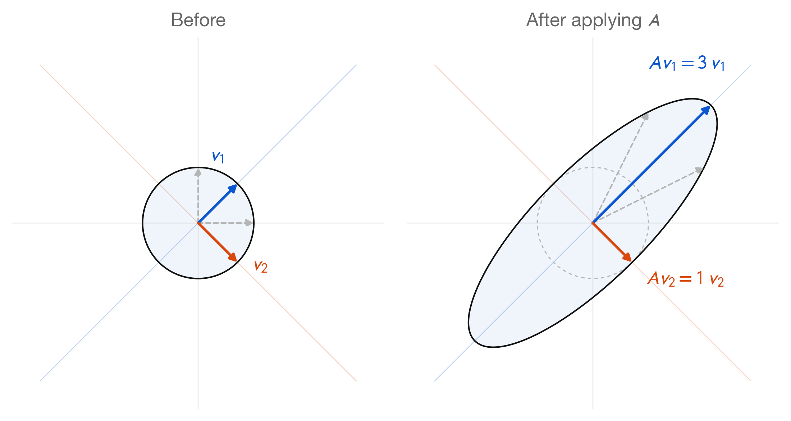

Eigendecomposition is a factorization of a diagonalizable square matrix, $A$, into a canonical form,

$$
A = Q \Lambda Q^{-1}, \tag{1}
$$

where $\Lambda$ is a diagonal matrix containing the **eigenvalues** of $A$, and $Q$ is a matrix containing the corresponding **eigenvectors**.

> **Note:** In spectral decomposition, the factorized matrix must also be normal (e.g. real symmetric), which makes $Q$ orthogonal (unitary).

Eq. (1) is built from the eigenvalue equation:

$$
A v_i = \lambda_i v_i, \quad v_i \neq 0, \tag{2}
$$

Here, $v_i$ is the $i$-th **eigenvector** of $A$, a nonzero vector that $A$ only scales, and $\lambda_i$ is its **eigenvalue**, the scaling factor. The $v_i$ are the columns of $Q$ and the $\lambda_i$ are the diagonal entries of $\Lambda$. This makes it clear that stacking Eq. (2) for all $i$ gives $AQ = Q\Lambda$, and multiplying on the right by $Q^{-1}$ recovers Eq. (1).

Like me, you probably recall these definitions from an introductory linear algebra course (if not, I highly recommend Gilbert Strang's [Introduction to Linear Algebra](https://math.mit.edu/~gs/linearalgebra/)). I know these definitions by rote because eigendecomposition constantly comes up in my statistical coursework and research. Even so, I believe it could be worthwhile to outline here, in the form of a blog post, to further ingrain its mathematical significance. 

Let's first glance at eigendecomposition from a geometric perspective.

## Geometric Intuition

A matrix is often described as a linear transformation of a vector space. Matrix $A$ takes every vector $x$ and sends it to $Ax$. $x$ can be stretched, rotated and sheared all at once. As a consequence, the magnitude and direction of $x$ generally change. However, eigenvectors are special in that their direction remains unchanged (or reversed) after transformation. They are only scaled by their matching eigenvalue, as defined in Eq. (2). 

Take the symmetric square matrix,

$$
A = \begin{bmatrix} 2 & 1 \\ 1 & 2 \end{bmatrix}.
$$

It has eigenvectors $v_1 = (1, 1)/\sqrt{2}$, $v_2 = (1, -1)/\sqrt{2}$ with corresponding eigenvalues $\lambda_1 = 3$, $\lambda_2 = 1$. 

Along direction $v_1$, matrix $A$ stretches space by a factor of 3 and along $v_2$, it leaves lengths unchanged. The eigenvectors simply point in directions where the matrix acts as pure scaling.

We can also visualize this graphically. Applying $A$ to a unit circle, with a set of vectors of length 1 for every possible direction, transforms it to an ellipse. Eigenvectors $v_1$ and $v_2$ are only stretched by their eigenvalues, while  other directions are also rotated.

*Figure 1: Matrix $A$ maps the unit circle to an ellipse. Its axes lie along the eigenvectors $v_1$ and $v_2$, scaled by $\lambda_1 = 3$ and $\lambda_2 = 1$. The dashed grey vectors are not eigenvectors, so their directions do in fact change.*

This basic example helps us understand the geometric intuition behind eigendecomposition, but we have yet to explore how to actually find the eigenvalues and eigenvectors. I'll get to this in the following section.

## Finding eigenvalues and eigenvectors

Rearranging the eigenvalue equation, Eq. (2), gives,

$$
(A - \lambda I)\,v = 0, \quad v \neq 0, \tag{3}
$$

where $I$ is the identity matrix. $v$ is being sent to zero by $A - \lambda I$. Matrix $A - \lambda I$ must then be singular, as it collapses a direction of space onto the origin. Therefore:

$$
\det(A - \lambda I) = 0. \tag{4}
$$

This is the **characteristic equation** and it's roots are the eigenvalues of $A$. For our matrix,

$$
\det(A - \lambda I) = \det\begin{bmatrix} 2-\lambda & 1 \\ 1 & 2-\lambda \end{bmatrix} = (2-\lambda)^2 - 1 = (\lambda - 3)(\lambda - 1) = 0,
$$

so $\lambda_1 = 3$ and $\lambda_2 = 1$, matching the stretches we saw in Figure 1.

To find the eigenvector for $\lambda_1 = 3$, substitute into Eq. (3):

$$
\begin{bmatrix} -1 & 1 \\ 1 & -1 \end{bmatrix} v_1 = 0 \;\Rightarrow\; v_1 \propto \begin{bmatrix} 1 \\ 1 \end{bmatrix}.
$$

Normalizing gives $v_1 = (1, 1)/\sqrt{2}$. The same steps for $\lambda_2 = 1$ give $v_2 = (1, -1)/\sqrt{2}$.

We now have all we need for Eq. (1). Placing the eigenvectors in the columns of $Q$ and the matching eigenvalues on the diagonal of $\Lambda$,

$$
Q = \frac{1}{\sqrt{2}}\begin{bmatrix} 1 & 1 \\ 1 & -1 \end{bmatrix}, \quad \Lambda = \begin{bmatrix} 3 & 0 \\ 0 & 1 \end{bmatrix}.
$$

For this $Q$, $Q^{-1} = Q$. This is because $Q$ is orthogonal which comes from $A$ being symmetric. So,

$$
Q \Lambda Q^{-1} = \frac{1}{2}\begin{bmatrix} 1 & 1 \\ 1 & -1 \end{bmatrix}\begin{bmatrix} 3 & 0 \\ 0 & 1 \end{bmatrix}\begin{bmatrix} 1 & 1 \\ 1 & -1 \end{bmatrix} = \begin{bmatrix} 2 & 1 \\ 1 & 2 \end{bmatrix} = A.
$$

Everything ties back together very nicely!

## Determinant and eigenvalues

The geometry in Figure 1 hints at a link between the determinant and the eigenvalues. $A$ stretches the unit circle by 3 along $v_1$ and by 1 along $v_2$, so it scales area by $3 \times 1 = 3$. The determinant measures exactly this area scaling, and $\det(A) = 2 \cdot 2 - 1 \cdot 1 = 3$.

Coincidence? Not quite, see here! Taking the determinant of Eq. (1) and using $\det(XY) = \det(X)\det(Y)$,

$$
\det(A) = \det(Q)\,\det(\Lambda)\,\det(Q^{-1}) = \det(\Lambda) = \prod_{i=1}^{n} \lambda_i, \tag{5}
$$

where the $\det(Q)$ and $\det(Q^{-1}) = 1/\det(Q)$ factors cancel, and the determinant of the diagonal matrix $\Lambda$ is the product of its diagonal entries. In plain words: **the determinant of $A$ is the product of its eigenvalues, the product of the stretches along each eigenvector.** I think that's pretty neat!

Alright, well I should probably mention that the example we have been following is a rather special case, a spectral one.

## Spectral Decomposition

In the introduction, I noted that for spectral decomposition, the factorizable matrix must also be normal. Spectral decomposition is eigendecomposition for the nicest class of matrices. The **spectral theorem** says that for a real symmetric $A$: all eigenvalues are real and the eigenvectors can be chosen orthonormal (repeated-eigenvalue case allows choice). So $Q$ is orthogonal and $Q^{-1} = Q^\top$. This gives:

$$A = Q \Lambda Q^\top = \sum_{i=1}^{n} \lambda_i v_i v_i^\top. \tag{6}$$

Each $v_i v_i^\top$ projects onto the direction $v_i$, and $\lambda_i$ is the weight.

For our example, Eq. (6) reads $A = 3\,v_1 v_1^\top + 1\,v_2 v_2^\top$: a stretch by 3 along $v_1$ plus a stretch by 1 along $v_2$.

This is why the ellipse axes in Figure 1 line up with the eigenvectors: for a non-symmetric matrix the eigenvectors are generally not perpendicular, so you lose that alignment. 

Covariance matrices are symmetric, so principal component analysis follows this exact form, which is a technique frequently used in my own scientific research. 

## Conclusion

A diagonalizable square matrix can be factored into its eigenvectors and eigenvalues, where along each eigenvector the matrix simply scales space by the corresponding eigenvalue. This fundamental linear algebra technique is widely applied over diverse scientific domains and remains pertinent as high-dimensional data continues to emerge. 

